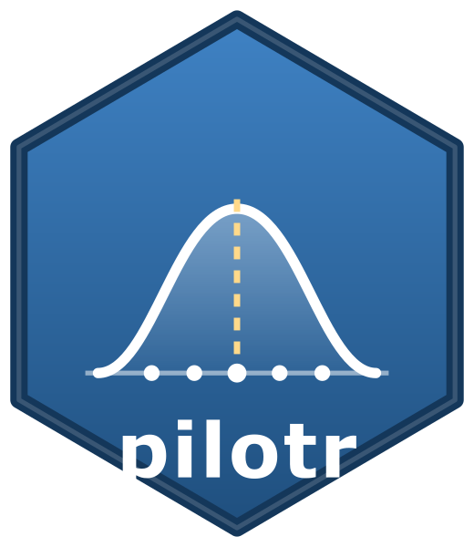

# pilotr, a cross-language toolkit for simulating experimental and behavioural data



<!-- badges: start -->
[](https://github.com/pablobernabeu/pilotr/actions/workflows/R-CMD-check.yaml)
[](https://github.com/pablobernabeu/pilotr/actions/workflows/python-tests.yml)
[](https://CRAN.R-project.org/package=pilotr)
[](https://pypi.org/project/pilotr/)
[](https://lifecycle.r-lib.org/articles/stages.html#experimental)
[](https://opensource.org/license/MIT)
[](https://doi.org/10.5281/zenodo.21266313)
<!-- badges: end -->

`pilotr` lets researchers pilot a study before they run it.

## Why pilotr

Most planning tools ask for one effect size and return one power figure. A study has more in it
than that. It has groups and conditions, crossed by-subject and by-item variation, and outcomes
that are rarely Gaussian, such as reaction times, accuracy, counts and Likert ratings. pilotr
lets you describe that whole design and then generates the data the design would produce.
Before collecting anything, you can see how often the planned analysis would detect the effect
and, when an estimate does reach significance, how far it would be exaggerated (a Type M error)
or take the wrong sign (a Type S error). It turns a design on paper into evidence about whether
the design is worth running. For accuracy and counts, the R package fits logistic and Poisson
mixed models, so Type M is measured on the logit or log scale on which the effect is written.
Likert ratings and proportions are analysed through a Bayesian design analysis, on the logit
scale of their model.

## How it works

A design is written once, as a small portable specification. That one specification drives three
interchangeable front-ends which produce identical data, namely a no-code web app, an R package
and a Python package. Together they close the loop from design to simulation to analysis, and on
to simulation-based power and design analysis.

pilotr succeeds the *Experimental-data-simulation* Shiny app (Bernabeu & Lynott, 2024), archived
on Zenodo (doi:10.5281/zenodo.10615953). The prototype drew marginal distributions only
(`rnorm`/`rbinom`, with no effects, correlations or random structure), whereas pilotr is a
generative toolkit built around effect sizes, random structure and realistic response families.

## Documentation

Everything is published from one site, <https://pablobernabeu.github.io/pilotr/>, whose landing
page points at the three parts. The R package's reference and articles live at
<https://pablobernabeu.github.io/pilotr/r/>, including a guide to
[the no-code app](https://pablobernabeu.github.io/pilotr/r/articles/the-no-code-app.html).
The Python package's guides and API reference are at
<https://pablobernabeu.github.io/pilotr/python/>. The no-code app itself can be tried in the
browser, with nothing to install, at <https://pablobernabeu.github.io/pilotr/app/>. The
portable JSON spec and the RNG contract are documented in [`spec/SPEC.md`](spec/SPEC.md).

## Installation

The Python package is on [PyPI](https://pypi.org/project/pilotr/) and the R package is on
[CRAN](https://CRAN.R-project.org/package=pilotr).

```bash
pip install pilotr             # core engine, pure Python and dependency-free
pip install "pilotr[power]"    # + scipy, for simulation-based power
pip install "pilotr[mixed]"    # + scipy, statsmodels and pandas, for crossed mixed-effects power
```

```r
install.packages("pilotr")
```

The development version of the R package installs from this repository, where it sits in the
`r/pilotr` subdirectory:

```r
# install.packages("remotes")
remotes::install_github("pablobernabeu/pilotr", subdir = "r/pilotr")
```

Neither package is needed to try the no-code app, which runs entirely in the browser.

## How pilotr compares to existing tools

The table below places pilotr beside the packages researchers most often reach for when planning
a study.

| Capability | faux | simstudy | simr / Superpower | pilotr |
|---|:--:|:--:|:--:|:--:|
| Generative IV→DV effect sizes | ✗ | ✓ | (from fitted model) | ✓ |
| Crossed by-subject and by-item random slopes | ✓ | partial | ✓ | ✓ |
| Realistic distributions (RT/count/ordinal) | ✓ | ✓ | family-dependent | ✓ |
| Simulation-based power + Type S/M | ✗ | ✗ | ✓ (power only) | ✓ |
| No-code GUI | ✗ | ✗ | ANOVA only | ✓ |
| Python implementation | ✗ | ✗ | ✗ | ✓ |
| R = Python data from one spec | — | — | — | ✓ |

No single existing tool spans these capabilities, and the Python-implementation row is empty
apart from pilotr. SDV learns from real data, pyDOE3 builds design matrices, Faker produces
placeholder values and the statsmodels power module covers analytic classical tests only.

The last row deserves its exact scope. On Linux, where R and Python share a maths library, every
shipped example and every case of the parity harness in [`tools/parity/`](tools/parity)
reproduces bit for bit, rounded or not, and CI enforces it. IEEE-754 fixes the rounding of
arithmetic but not of `exp()`, `log()` and `pow()`, and on Windows the two languages take those
from different libraries. There, a value that passes through one of them can differ in its last
bits. [Cross-language reproducibility](#cross-language-reproducibility) below gives the measured
rates.

## Repository layout

```
pilotr/  (repo root)
  spec/          The portable design-specification format (the conceptual core)
    SPEC.md          human-readable format documentation + the RNG contract
    design.schema.json   JSON Schema for validation
    examples/        worked design specs (between-groups; crossed mixed-effects RT)
  python/        pilotr Python package (runnable; pure-Python generative core)
  r/pilotr/      pilotr R package (mirrors the Python core exactly)
    inst/app/      the no-code Shiny app, bundled in the package (pilotr::run_app())
  app-lite/      serverless (shinylive/webR) build of the light path -> static site
  hpc/           SLURM array job for large precision sweeps on a cluster
  tools/parity/  cross-language parity harness: the CI gate behind the bit-identical claim
    tolerance.json   the per-case ulp allowance, and which cases pass through exp() or log()
    golden.json      hashes of the Gaussian R dumps, so the two halves cannot drift together
  docs/
    mixed_models_and_design_analysis.md   continuous predictors, interactions, the brms bridge
```

## One model, three interfaces

The same design spec drives a no-code web app, an R package and a Python package. The app is a
thin client. Every control writes into the portable JSON spec, which can be downloaded and run
unchanged in either package to obtain identical data.

```r
# launch the no-code app locally (installed package)
pilotr::run_app()
# ...or from source:
shiny::runApp("r/pilotr/inst/app")
```

## Deployment and concurrency

R is single-threaded. One R process runs one computation at a time, and a heavy
simulation-based power run (hundreds to thousands of model fits) blocks every other user
sharing that process. The architecture is therefore split according to how the tool is used.

| Path | How | Concurrency | Use for |
|---|---|---|---|
| Installable (primary) | `pilotr::run_app()` in R, or `import pilotr` for Python scripting (installed with `install.packages("pilotr")` or `pip install pilotr`) | unbounded, each user on their own machine and cores | real work, especially heavy power runs parallelised across cores |
| Serverless demo | `app-lite/` exported with shinylive to a static site on GitHub Pages | unbounded, each browser computes via WebAssembly | a low-cost link for design, simulation and Gaussian power |
| Shared hosted instance | shinyapps.io or ShinyProxy | low and costly | best avoided as the main channel, since it blocks and the prototype's free tier allowed 25 hours per month |

In the installable app, each power analysis and power curve runs in one R process, and the
session that asked for it waits for the result. With `future` and `promises` installed,
`run_app()` runs it in a background process, which leaves the app's own R process free for
other sessions, such as a second browser tab. Heavy runs belong in `power_design()` or
`power_mixed()` called from the console, whose `workers` argument spreads the replicates over
local cores. The serverless build is single-user-per-browser and runs synchronously. Both are
driven by the same spec, so a user can design in the browser demo and then run heavy power
locally from the downloaded spec.

```bash
# build the serverless static site (downloads webR assets on first run)
Rscript app-lite/build_shinylive.R   # -> build/shinylive-demo/

# The published website is built by CI (.github/workflows/site.yml): the pkgdown docs at
# https://pablobernabeu.github.io/pilotr/r/ and this demo at https://pablobernabeu.github.io/pilotr/app/
```

## Running at scale (HPC / SLURM)

Simulation-based power and precision analyses are embarrassingly parallel, so they scale well on
a cluster. Within one machine, every power and precision analysis takes a `workers` argument
that parallelises the replicates in-process, with results identical to a serial run, while the
SLURM array below covers multi-node sweeps. The [`hpc/`](hpc/) directory holds a SLURM array job
([`precision_array.slurm`](hpc/precision_array.slurm) and its runner
[`precision_array.R`](hpc/precision_array.R)) that runs one task per sample size. Each task calls
`precision_design()` at its size, with the replicates spread across the task's cores, so its
output has the columns and fit counts of `precision_curve()`.

The job runs on any SLURM cluster once the two values marked in the wrapper are filled in. They
are the account the scheduler charges and `PROJECT_DIR`, a writable directory for the R library
and the results. Clusters often give home directories a small quota, so a project or scratch area
usually suits it better. Install the packages into that library once, on a login node, from the
root of the clone:

```bash
module load R                          # or the versioned R module your cluster names
export PROJECT_DIR=$HOME/pilotr_runs   # the value set in the wrapper
export R_LIBS="$PROJECT_DIR/Rlib"
mkdir -p "$R_LIBS"
Rscript -e 'install.packages(c("jsonlite", "lme4", "lmerTest"), repos = "https://cloud.r-project.org")'
R CMD INSTALL --library="$R_LIBS" r/pilotr
```

pilotr is installed from the clone so that the package and the job's runner come from the same
commit. Then, from `hpc/`, `sbatch precision_array.slurm` runs the sweep, and
`sbatch --export=ALL,N_SIMS=4 --array=0 precision_array.slurm` is a quick smoke test. SLURM
writes each task's log to `hpc/`. Each task writes one `precision_N<n>.csv` to
`$PROJECT_DIR/results`, and bound together the files form the curve that `precision_curve()`
returns over the same grid, at a resolution far beyond a laptop. `solve_curve()` then gives the
sample size at which a focal effect reaches a determinate decision with the target probability:

```r
library(pilotr)
results <- file.path(Sys.getenv("PROJECT_DIR"), "results")
files <- list.files(results, pattern = "^precision_N[0-9]+[.]csv$", full.names = TRUE)
curve <- do.call(rbind, lapply(files, read.csv))
solve_curve(curve, target = 0.9, effect = "SyntaxPC")
```

Each task takes the seed that `sweep_spec()` gives its point of the grid. The points of the curve
are therefore independent, as `solve_curve()` assumes, and a local `precision_curve()` over the
same grid simulates the same data. That exactness covers the simulated data alone. The cluster
reproduces them exactly when both machines round `exp()`, `log()` and `pow()` alike, as two Linux
machines with the same C library do. Between Windows and Linux, values that pass through those
functions can differ in their last bits, as
[Cross-language reproducibility](#cross-language-reproducibility) below sets out. The model fits
also depend on the lme4 release, whose optimiser defaults have changed over time, and on the
platform's numerical libraries. Each row of a task's output therefore records the versions of
pilotr and lme4 that produced it.

## Cross-language reproducibility

Native random-number generators differ across ecosystems. R uses Mersenne-Twister with
inversion, whereas NumPy uses PCG64, so a naive port never matches. `pilotr` instead ships a
shared generator implemented identically in both languages.

Uniform deviates come from L'Ecuyer's (1988) combined linear congruential generator, whose
intermediate products stay below 2^53 and so remain exact in IEEE-754 doubles (R) and Python
integers alike. Normal deviates use Wichura's (1988) Algorithm AS 241 inverse-CDF, the algorithm
behind R's `qnorm()`. Everything else (Cholesky factors for correlated random effects, and
inverse-CDF draws for the Poisson, Bernoulli and ordinal families) derives from those two in a
documented draw order (see [`spec/SPEC.md`](https://github.com/pablobernabeu/pilotr/blob/main/spec/SPEC.md)).
The same specification and seed therefore yield identical data in R and Python wherever the two
share a maths library, as on Linux, where CI checks every case to the last bit.

IEEE-754 leaves the rounding of `exp()`, `log()` and `pow()` to that library, and on Windows R
and Python do not share one. There, a value that passes through those functions can differ in its
last bits, and every family has such a path. AS 241 calls `log()` in its tails, and about 1.4e-5
of normal draws differed, by 1 to 3 units in the last place, so even Gaussian data can differ.
Responses of the lognormal families and the ex-Gaussian differed by 1 unit, and an unrounded
Beta response by up to 35. A discrete outcome can in principle move by a whole category, though
none did in 50,000 rows of each family. Rounding to four decimals removed every continuous
difference measured, but it guarantees nothing, since a last-bit difference can straddle a
rounding boundary. One Beta case can differ on Linux too. From R 4.6.0, R's `^` computes a cube
or a fourth power by repeated multiplication, where Python calls `pow()`. A Beta response whose
Gamma shape is exactly 1/3 or 1/4 can therefore differ in its last bits on any platform. Within
one language, the data are identical on one platform, and across operating systems on the same
terms as across languages.
[`spec/SPEC.md`](https://github.com/pablobernabeu/pilotr/blob/main/spec/SPEC.md#scope-of-the-guarantee)
sets out the scope, and [`tools/parity/tolerance.json`](tools/parity/tolerance.json) records the
harness's allowances. The generator is auditable and free of external dependencies.

## Quick start

Every command below runs from the repository root.

### Simulate a design, in either language

The two demo scripts are the shortest way in. Each simulates the bundled designs and runs
classical simulation-based power with the Type S and Type M errors, and the parity check then
confirms that the two languages produce identical data.

```bash
python python/examples/run_demo.py         # Python
Rscript r/pilotr/examples/run_demo.R       # R, bit-for-bit the same
python python/examples/parity_check.py     # identical to write precision (see the cross-language vignette)
```

Realistic response families have a demo of their own, covering ordinal (Likert) outcomes and
Poisson counts.

```bash
python python/examples/families_demo.py
```

### Power and design analysis

Three R scripts cover this ground. The first runs crossed mixed-effects power through `lme4`
and `lmerTest`. The second validates the generative model by fitting a maximal `lmer` model and
checking that it recovers the specified parameters. The third covers continuous predictors,
interactions and continuous random slopes, together with a precision-based ROPE design analysis,
an N-sweep, the solve that turns such a curve into a sample size with a confidence interval on
it (`solve_curve()`, or `target_n()` for a power curve), and a brms bridge (documented in
[`docs/mixed_models_and_design_analysis.md`](docs/mixed_models_and_design_analysis.md)).

```bash
Rscript r/pilotr/examples/run_power_mixed.R
Rscript r/pilotr/examples/validate_recovery.R
Rscript r/pilotr/examples/precision_design_analysis.R
```

Python runs mixed-effects power through statsmodels. Its `power_mixed` fits the model the
specification implies, which ports of the R package's `model_formula()` and `model_data()` build.
Every coefficient is a fixed effect, and every declared random intercept and slope, an extra
grouping factor's included, is an independent variance component, with the response logged for
the two lognormal families. It tests every coefficient, or the effects that `focal` names. It
leaves out the correlations between random effects, which the R package's `power_mixed()`
estimates, and warns when a specification declares them. A design without random effects is
refused, where R fits it with `lm()` or `glm()`. The note closing the Quick start explains where
the two estimators diverge.

```bash
python python/examples/power_mixed_demo.py
```

### Power curves and the publication figure

The Gaussian curve is quick. The crossed mixed curve is slow, because every point on it is a set
of `lme4` fits. A third script draws both into one figure.

```bash
python python/examples/power_curves.py        # Gaussian curve  -> build/*.csv
Rscript r/pilotr/examples/power_curve_mixed.R # crossed mixed curve (slow, lme4)
Rscript r/pilotr/examples/plot_power_curves.R # -> build/power_curves.png
```

### Cross-checks and tests

Two further scripts check that pilotr agrees with faux and simstudy where the three overlap, and
the Python validation suite exercises the generative core.

```bash
Rscript r/pilotr/examples/equivalence_faux.R
Rscript r/pilotr/examples/equivalence_simstudy.R
python -m pytest python/tests -q
```

> A note on R and Python coverage. Data generation is bit-identical across languages wherever
> they share a maths library, as on Linux (see Cross-language reproducibility above), and both
> ecosystems run crossed mixed-effects power from the same spec. The mixed-model analyses,
> however, differ. R (`lme4`/`lmerTest`, REML) fits the model the specification implies,
> correlations included, and tests with Satterthwaite's approximation. Python (`statsmodels`
> MixedLM, REML) fits the same model with independent variance components, reaching the optimum
> that `lme4` reaches for the same components, and tests with a Wald z. With few subjects or items, a Wald z rejects
> more readily than Satterthwaite's test
> ([Luke, 2017](https://doi.org/10.3758/s13428-016-0809-y)), so in small designs Python's power
> tends to exceed R's on the same data. On the 12 × 8 design of the Python power guide, 6 of 12
> replicates are significant in Python and 4 in R. With 8 subjects, 6 items, random intercepts
> alone and no true effect, Python rejected in 0.070 of 300 replicates (Monte Carlo standard
> error 0.015). On the same data, R's Satterthwaite test of the same model rejected in 0.057
> ([`tools/calibration/wald_null_rate.py`](tools/calibration/wald_null_rate.py)). The two-group
> Gaussian power backend is identical in both languages. For correlated random slopes, R is the
> recommended choice.

## Citation

If pilotr contributes to published work, please cite the package you used, with its version.
The R package's reference gives the DOI that CRAN assigned to it on publication, which names the
R package across its versions:

> Bernabeu, P. (2026). *pilotr: Simulate experimental and behavioural data from a portable design
> specification* [R package]. <https://doi.org/10.32614/CRAN.package.pilotr>

The Python package's reference gives the concept DOI of the Zenodo archive, which holds every
GitHub release of both packages, since PyPI assigns no DOI:

> Bernabeu, P. (2026). *pilotr: Simulate experimental and behavioural data from a portable design
> specification* [Python package]. <https://doi.org/10.5281/zenodo.21266313>

The R and Python packages are released separately, so their version numbers can differ. In R,
`citation("pilotr")` gives the reference with the installed version. The About page of each
documentation site gives it with that package's version and a BibTeX entry, for
[the R package](https://pablobernabeu.github.io/pilotr/r/articles/about.html) and for
[the Python package](https://pablobernabeu.github.io/pilotr/python/about/). GitHub builds a
ready-made citation from [`CITATION.cff`](CITATION.cff) through its *Cite this repository*
button. That file describes both packages, so it gives the Zenodo DOI, which favours neither,
and lists each package's identifiers.

## Licence

MIT. See [LICENSE](LICENSE).

## Contributing

Issues and pull requests are welcome. The [contributing guide](.github/CONTRIBUTING.md) describes
the development setup and the conventions the toolkit follows, and everyone taking part is asked
to honour the [Code of Conduct](.github/CODE_OF_CONDUCT.md).
