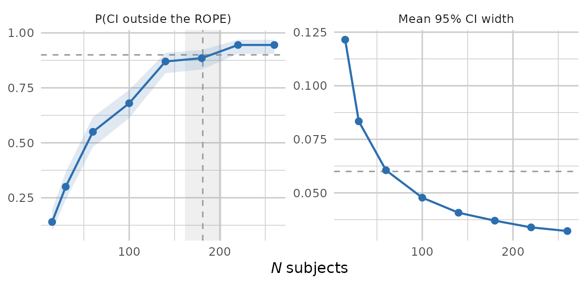

# Precision and ROPE design analysis

``` r

library(pilotr)
```

When sample sizes are large, or when the question of interest is whether
an effect is *practically* meaningful, power against a point null is
often the wrong target. pilotr implements a precision-based design
analysis against a region of practical equivalence (ROPE). This is a
fast, frequentist analogue of the Bayesian approach that compares a
highest-density interval with a ROPE.

> As in the power vignette, the fixed-*N* analysis below uses a small
> `n_sims` so that the vignette builds quickly, and the sample-size
> sweep, which needs far more model fits, was precomputed with exactly
> the code shown and shipped with the package. For real planning we
> recommend `n_sims >= 200`, the value the sweep uses.

## The idea

Over Monte Carlo replicates, and for each focal fixed effect, pilotr
records the 95% confidence interval and whether it falls determinately
outside the ROPE (the effect is practically meaningful) or entirely
inside it (practical equivalence to zero), together with the expected
interval width. The interval is a Wald approximation, the estimate plus
or minus 1.96 standard errors, chosen for speed and for comparability
across replicates. Sweeping sample size then locates the minimum *N* at
which a focal effect reaches a determinate decision with a target
probability.

## A worked design

We reuse the crossed priming design, which represents a small priming
effect on log reaction time. Every subject sees every item in both
conditions. A counterbalanced study, in which each subject sees each
item in one condition only, has half the observations and wider
intervals, so it needs more subjects than the sweep below finds. Plan
such a study with `counterbalance = TRUE` in
[`build_spec()`](https://pablobernabeu.github.io/pilotr/r/reference/build_spec.md),
which needs specification version 0.4, or with the two-list encoding
among the [worked
encodings](https://github.com/pablobernabeu/pilotr/blob/main/spec/SPEC.md#worked-encodings)
of the specification, which earlier releases read too.

``` r

spec_c <- build_spec(list(
  name = "priming", seed = 1, design_kind = "within", include_items = TRUE,
  n_subject = 24, n_item = 18,
  factor_name = "condition", lev1 = "related", lev2 = "unrelated",
  intercept = 6, effect = 0.05,
  subj_int_sd = 0.12, subj_slope_sd = 0.04, subj_corr = 0.2,
  item_int_sd = 0.08, item_slope_sd = 0.02, item_corr = -0.1,
  family = "shifted_lognormal", resp_name = "RT", sigma = 0.3, shift = 200))
```

So that the analysis can run from the specification alone, pilotr
auto-derives the analysis model, including the contrast columns, the
response transform and the mixed-model formula.

``` r

model_formula(spec_c)
```

    .y ~ effect + (1 + effect | subject) + (1 + effect | item)

The companion
[`model_data()`](https://pablobernabeu.github.io/pilotr/r/reference/model_data.md)
adds the other two derivations to a simulated data set, the numeric
`effect` contrast column the formula’s terms refer to and the `.y`
response, here the log-transformed RT because the family is
`shifted_lognormal`.

``` r

head(model_data(spec_c, simulate_design(spec_c)))
```

      subject item condition       RT       .y effect
    1       1    1   related 688.7993 6.191952   -0.5
    2       1    1 unrelated 778.3731 6.360219    0.5
    3       1    2   related 884.1392 6.528161   -0.5
    4       1    2 unrelated 788.8995 6.378256    0.5
    5       1    3   related 651.0253 6.111523   -0.5
    6       1    3 unrelated 518.3355 5.763106    0.5

## Precision at a fixed *N*

We declare the focal effect (its coefficient name and true value) and a
ROPE half-width. Here the effect lives on the log scale, and we treat
anything smaller than 0.02 as practically equivalent to zero.

``` r

pr <- precision_design(
  spec_c, focal = c(effect = 0.05), rope = 0.02, n_sims = 25)
pr
```

       param true mean_ci_width p_meaningful p_meaningful_mcse p_meaningful_lo
    1 effect 0.05    0.09809118         0.28        0.08979978       0.1428385
      p_meaningful_hi p_equivalent p_equivalent_mcse p_equivalent_lo
    1       0.4757661            0                 0               0
      p_equivalent_hi n_attempted n_returned n_converged n_singular n_warning
    1       0.1331923          25         25           8         17         0
                  fitter
    1 lme4::lmer, Wald z

The columns are interpreted as follows. `p_meaningful` is the
probability the 95% CI lands entirely outside the ROPE, a determinate
‘meaningful’ decision. `p_equivalent` is the probability it lands
entirely inside, a determinate ‘equivalent’ decision. `mean_ci_width` is
the expected precision.

## Sweeping sample size

The same ROPE has to be carried into the sweep. Leaving `rope` at its
default would compare the interval against a region as wide as the
effect itself, and the decision probability would then fall away as *N*
grew, which is backwards.

``` r

prc <- precision_curve(spec_c, focal = c(effect = 0.05),
                       subject_ns = c(15, 30, 60, 100, 140, 180, 220, 260),
                       rope = 0.02, n_sims = 200)
print(prc[, c("n_subject", "p_meaningful", "p_equivalent", "mean_ci_width",
              "n_returned", "n_singular")], digits = 3)
```

      n_subject p_meaningful p_equivalent mean_ci_width n_returned n_singular
    1        15        0.140            0        0.1215        200        156
    2        30        0.300            0        0.0834        200        141
    3        60        0.550            0        0.0605        200        113
    4       100        0.680            0        0.0478        200         97
    5       140        0.870            0        0.0407        200         82
    6       180        0.885            0        0.0370        200         74
    7       220        0.945            0        0.0339        200         46
    8       260        0.945            0        0.0322        200         55

As *N* grows the interval tightens and `p_meaningful` rises, so the
design reaches a determinate decision more reliably. That is a more
informative criterion than power against a point null, because it asks
whether the study can distinguish the effect from a negligible one,
where power asks only whether it can be distinguished from zero. Each
probability is a proportion over the replicates that returned an
estimate, `n_returned`, 200 at each size here, so its Monte Carlo
standard error is at most 0.035. The figure below draws the Wilson
interval of `p_meaningful` as a band.

`n_singular` counts the fits whose variance estimates sat on a boundary,
156 at 15 subjects and 55 at 260. `n_converged`, in the full result,
counts those with neither a singular fit nor a warning. Singular fits
are kept in the proportions, since their fixed-effect estimates remain
interpretable and discarding them would bias the result. A large
`n_singular` says that the model is richer than the design can support
at that size.

Scanning the table for the smallest simulated *N* that meets a target of
‘`p_meaningful` ≥ 0.90’ gives 220 subjects. That answer is a property of
where the grid points happen to fall, and it comes without an interval.
[`solve_curve()`](https://pablobernabeu.github.io/pilotr/r/reference/solve_curve.md)
fits the decision probability against the sample size and inverts the
fit, so all eight points inform the answer, where scanning the table
uses only the two either side of the target.

``` r

solved <- solve_curve(prc, target = 0.9)
unlist(solved[c("value", "lo", "hi", "dispersion")])
```

         value         lo         hi dispersion 
    181.127671 161.378958 202.016032   2.287547 

The fitted crossing is 181 subjects. With 200 replicates per point, this
design needs somewhere between 161 and 203 subjects to reach a
determinate ROPE decision nine times in ten. The 220 read by eye lies
above that interval. Only the interval says how far the answer could
move, and a preregistration quoting a single figure would be claiming
more than the simulation supports. The fit is a binomial probit
regression weighted by the replicates behind each point, and the
interval is the delta-method interval that
[`MASS::dose.p()`](https://rdrr.io/pkg/MASS/man/dose.p.html) computes
for a fitted `glm`.

The `dispersion` is Pearson’s chi-square over its degrees of freedom,
floored at 1, and here it is 2.29. Above 1, it says the points scatter
about the fitted curve more than their replicate counts alone would
explain, and the interval is widened to match. That is the heterogeneity
factor of classical probit analysis. Nothing is extrapolated either: a
curve that never reaches the target within the sizes swept is refused,
and the refusal reports the range the sweep did cover.

[`power_report()`](https://pablobernabeu.github.io/pilotr/r/reference/power_report.md)
turns the solve into the sample-size justification a preregistration
needs. It takes a
[`precision_design()`](https://pablobernabeu.github.io/pilotr/r/reference/precision_design.md)
result at the chosen size, the
[`target_n()`](https://pablobernabeu.github.io/pilotr/r/reference/target_n.md)
result for this curve, which rounds the solve up to whole subjects, and
the region of practical equivalence as `rope`. It writes each effect’s
mean interval width and the probabilities of the two decisions, each
with its Monte Carlo error, beside the solved size and its interval. The
[power
vignette](https://pablobernabeu.github.io/pilotr/r/articles/power-analysis.md)
writes one for a power analysis.

`p_equivalent` stays at 0 throughout, and correctly so. The true effect
of 0.05 lies outside the ROPE by construction, so no interval should
ever land entirely inside it. The column earns its place in designs
where practical equivalence is the hypothesis of interest.

``` r

library(ggplot2)
# Each probability is a proportion over the replicates that returned an
# estimate, and the sweep carries its 95% Wilson interval, which the band draws.
# The two panels are on different scales, hence the free y axis.
panels <- c("P(CI outside the ROPE)", "Mean 95% CI width")
long <- rbind(
  data.frame(n_subject = prc$n_subject, panel = panels[1], y = prc$p_meaningful,
             lo = prc$p_meaningful_lo, hi = prc$p_meaningful_hi),
  data.frame(n_subject = prc$n_subject, panel = panels[2],
             y = prc$mean_ci_width,
             lo = NA, hi = NA))
long$panel <- factor(long$panel, levels = panels)
# 0.90 is the target decision probability. 0.06 is the width at which a CI
# centred on the true effect just clears the ROPE, that is 2 * (0.05 - 0.02).
refs <- data.frame(panel = factor(panels, levels = panels), ref = c(0.90, 0.06))
# The solved sample size and its interval, drawn only on the decision panel,
# since the width panel is on a different scale and answers a different question.
solve_band <- data.frame(panel = factor(panels[1], levels = panels),
                         lo = solved$lo, hi = solved$hi, at = solved$value)

ggplot(long, aes(n_subject, y)) +
  geom_hline(data = refs, aes(yintercept = ref), linetype = 2,
             colour = "grey60") +
  geom_rect(data = solve_band, inherit.aes = FALSE,
            aes(xmin = lo, xmax = hi, ymin = -Inf, ymax = Inf),
            fill = "grey60", alpha = .15) +
  geom_vline(data = solve_band, aes(xintercept = at), linetype = 2,
             colour = "grey60") +
  geom_ribbon(aes(ymin = lo, ymax = hi), alpha = .15, fill = "#2C6FB0",
              na.rm = TRUE) +
  geom_line(colour = "#2C6FB0", linewidth = 0.8) +
  geom_point(colour = "#2C6FB0", size = 2.2) +
  facet_wrap(~ panel, scales = "free_y") +
  labs(x = expression(italic(N) ~ "subjects"), y = NULL) +
  theme_minimal(base_size = 12) +
  # theme_minimal still paints a white plot.background over the transparent
  # canvas, so both surfaces have to be cleared for the page colour to reach the
  # figure.
  theme(plot.background  = element_rect(fill = NA, colour = NA),
        panel.background = element_rect(fill = NA, colour = NA),
        panel.grid       = element_line(colour = "grey80"),
        strip.background = element_rect(fill = NA, colour = NA))
```



The two panels answer the same question from either side. On the left,
the horizontal dashed line marks the 0.90 target, and the vertical band
the sample size solved against it. On the right the dashed line marks a
width of 0.06, which is where a confidence interval centred on the true
effect just clears a ROPE of 0.02, since the interval has to keep its
lower limit above the ROPE and so must be narrower than 2 × (0.05 −
0.02). Width falls below that line well before the decision probability
reaches 0.90, because an interval centred exactly on the true effect is
the best case and sampling variation moves the centre about.

## See also

The [power
vignette](https://pablobernabeu.github.io/pilotr/r/articles/power-analysis.md)
covers simulation-based power and Type S/M errors. The [getting-started
vignette](https://pablobernabeu.github.io/pilotr/r/articles/getting-started.md)
covers the core simulate-and-inspect loop.
